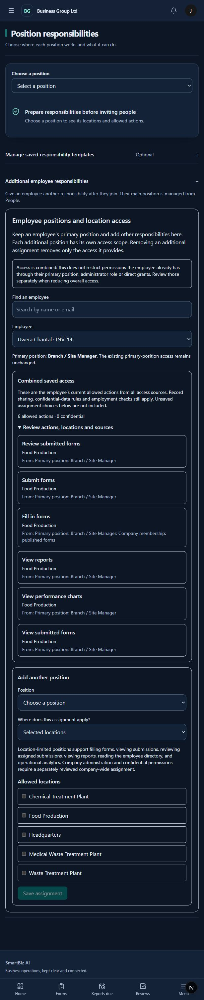

# Filing branches and combined access — 14 October 2026

General company forms now let people choose among active branches permitted by their existing form-use/submission access. Defaults are prepared for the selected branch; the same branch is sent when creating the draft. Fixed-branch forms stay fixed. Forms targeted to a department, team, branch audience or position audience retain their current context. This deliberately avoids expanding access or changing existing audience rules. A person with multiple choices and no initial branch must choose before saving. The choice is locked after saving or an uncertain save response; editing work-site answers remains descriptive.

Backend creation independently rejects foreign, inactive, out-of-scope and out-of-audience branch choices. Draft updates cannot change the original filing branch. Existing idempotent create and interrupted-upload retries retain their behavior.

Employee position setup now shows **Combined saved access**: actual effective actions, company-wide versus named-branch scope, confidential markers and contributing account, direct-grant, primary-position, additional-position and company-membership sources. It follows current authorization and requires company setup plus employee-management authority within the existing directory boundary. It reveals permission metadata, not private employee data. Inactive accounts receive no available actions. Assignment saves refresh the summary.

Verification: **15 targeted backend tests passed**, covering primary scope, filing choices, form journeys, draft immutability, combined access equality, unauthorized viewers and foreign-company isolation. Frontend retry/transport contracts passed, including forwarding the chosen branch. TypeScript, targeted lint, Django checks, strict API schema validation and the production frontend build (92 pages) passed. A signed-in branch-manager review showed six actions at Food Production and zero confidential permissions. Browser checks also verified the administrator branch selector, selected-branch work-site defaults, disabled saving without a required choice and discard protection for the temporary selection. No live permissions, employee status or form records were changed.

Remaining: combined access **before/after a proposed permission change**, a simpler guided assignment flow, configured request-type fields, wider unsaved-work protection and actual staging infrastructure/device checks. Combined saved access does not yet simulate proposed changes. Targeted forms intentionally keep their existing filing context.

