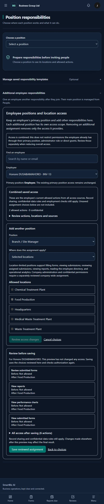

# Assignment access preview — 14 October 2026

Additional employee assignments now use a review-before-save flow. Choose the employee, position and locations, request an authorized preview, review actions and location coverage before/after, then explicitly save the reviewed choices. Revocation also previews what disappears and what remains through other sources. The preview lists all access after the proposed change and marks confidential actions. The save request uses the captured proposal rather than rebuilding it from later screen edits.

The server validates previews with the same assignment serializer and company/sensitive-permission policy used for saving. Previewing creates no assignment or audit change. It calculates combined projected access from the account role, direct grants, primary position, membership and remaining/proposed additional assignments. An account awaiting a primary position remains restricted. Preview access requires company organization, employee-management and setup authority. Foreign assignments, inactive locations, unsupported branch capabilities and unowned confidential grants remain blocked.

Existing assignments cannot be moved to another employee. Duplicate additional positions produce an actionable validation error directing the administrator to edit or reactivate the existing assignment. Unfinished choices trigger the shared navigation/browser warning; permission changes are never automatically saved when leaving. Editing controls are disabled during review, and Back to choices lets the administrator revise the proposal.

Verification: **12 primary-scope, filing and access-summary/preview checks passed**, including simulated-versus-saved equality for adding/revoking assignments, no preview writes, overlapping primary/direct access, company isolation, confidential permission protection, duplicates and employee rebinding. Frontend TypeScript and targeted lint passed; strict API schema validation passed. Signed-in browser checks previewed four added branch actions, retained existing form access, and verified discard protection. The temporary proposal was discarded. No live assignment or permission was saved.

The preview describes capability and branch coverage; record sharing, review routing and confidential-record policies still apply. Existing permission changes elsewhere between preview and save can affect the final result; save revalidates authorization. Remaining work includes previews for changing primary positions or a position's responsibility configuration across its affected employees, more guided setup, complete request-type policy fields and the wider staging checklist.

