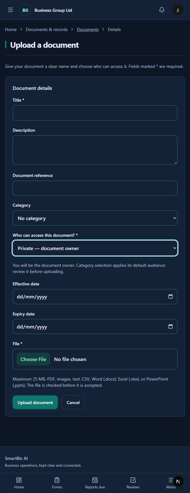

# Document and report notification improvements — 13 October 2026

First implementation batch from the system readiness review. Public deployment remains on hold while the other findings and staging checks are completed.

## Documents

- Consolidated the duplicated serializer validation. Category, owner, branch, department, team and project must belong to the signed-in company.
- Category defaults now apply on creation when no audience is supplied. Uploads without an owner are owned by the uploading user.
- Branch, department and team sharing require their corresponding destination. Retained relationships are validated during partial updates, including branch/department/team consistency and date order.
- Creation requires `initial_file`; metadata updates do not require another upload. File replacement uses the existing Add version endpoint.
- Document and initial version database writes are atomic. Existing content validation and scanner policy remain in force.
- Rebuilt the upload page with persistent labels, description/reference/category/date fields, plain-language audience choices, dependent scope selectors, supported formats and a 25 MB limit, visible server errors and unfinished-work protection.
- Audience/category lists read all pages from existing permission-filtered endpoints. Their caches include company and user identity. Private audience remains the initial page default.

## Report notifications

- Removed duplicate notification helper definitions that silently overrode earlier methods.
- Draft creation no longer produces a submitted-report notification. The notification is emitted after successful workflow submission and database refresh. Creation audit events say `REPORT_CREATED`.
- Submission and comment notifications check each recipient's current report visibility, company and active/nondeleted account.
- Incident/request update and deletion escalations also check report visibility before sending either an in-app notification or email. Deleted-report recipients are resolved before deletion removes workflow access evidence.
- Deletion notifications retain the original report identifier and link to the report list instead of a deleted detail page.

## Verification

- Django system check: passed; migration check: no changes detected.
- Frontend TypeScript check: passed. The generated development-route failure seen during the audit did not recur after normal route generation; no generated file was manually edited.
- Updated upload-page ESLint check: passed.
- Frontend production build: passed, including TypeScript and all 92 generated pages.
- Signed-in browser: private default, matching branch/department/team selectors, blocked submission without the selected scope, and Cancel unfinished-work protection verified. No company document or access grant was created during browser verification.
- Isolated regressions: **15 passed in 53.35 seconds**. `tests/security/test_document_report_privacy.py` covers tenant boundaries, category defaults, owner access, actual temporary-storage upload/version persistence, scoped metadata edits, file-required creation, dates, draft/submitted/comment privacy, critical-report escalations and deleted-reference retention. Test notifications are isolated; email sends in escalation tests are replaced with in-memory captures.

## Remaining readiness work

Continue the employee directory/access and headcount batch, company administrator leadership/profile setup, navigation aliases, position/permission clarity, branch/worksite form wording, wider form/navigation consistency, platform support metadata and legacy collection pagination. Employee directory access needs a safe separation of ordinary directory fields from private HR profile data before any scope expansion. Actual malware detection, production backup/restore, hosting and staging/device checks remain unverified.

