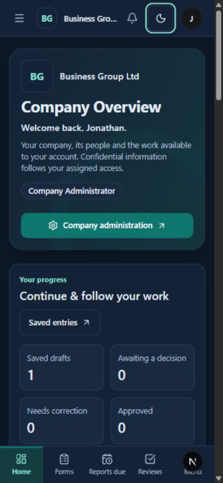
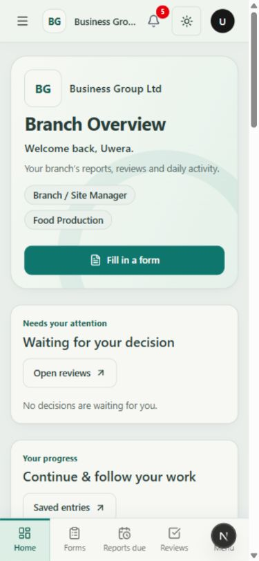

# Mobile company theme access

15 October 2026. Interpreted the reported unavailable small-screen mode switch as Light/Dark/System appearance control.

The company header previously hid its theme control below 640px; only the footer retained a selector. Added a compact, labelled native theme selector in the sticky mobile header with a 44px touch target, keyboard focus and the existing preference-save/error handling. Desktop retains its existing three-option control. The compact company name now truncates on one line rather than stretching the header on narrow phones; the full name remains available as a tooltip.

Verified the signed-in company dashboard at 390×844 and 320×740, including the visible sticky-header control while scrolled and the expanded selector's Light, Dark and System options. No preference was saved during verification. Restored the browser's original viewport afterward. TypeScript and targeted lint passed. This is browser viewport verification, not a physical-device test.

## Other company accounts

Verified the shared mobile header at 390×844 in the signed-in Branch / Site Manager and Employee dashboards. Manager Light mode persisted after reload while the employee remained Dark. Employee System mode persisted after reload; Light mode also saved successfully. Both users were restored to their original Dark preference, and the viewport override was reset. No business records or permissions were changed. The manager Light-mode screenshot was visually inspected.

The backend preference-security test passed (1 test in 217.50s), covering authenticated personal preference isolation, attempts to target another user, invalid values and unauthenticated access. Live cross-account verification also completed successfully.

