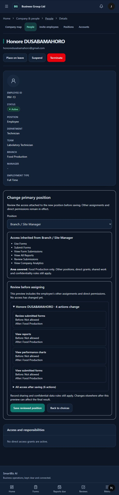
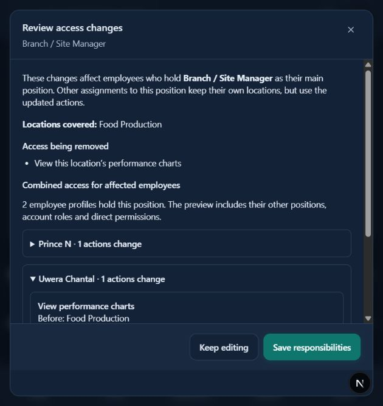

# Primary and position-wide access previews — 14 October 2026

Primary-position assignment now requires a combined-access review before the frontend save step. The preview includes the account role, direct grants and other active positions, shows action/location changes and lists all projected access. It uses the same company, active-position and sensitive-capability validation as saving. First assignments model the position's initial workplace and accepted-invitation access correctly. Existing primary-position changes retain the recorded workplace. Choices have unfinished-work protection and the save uses the reviewed position ID.

Position responsibility changes now show every affected employee through a paginated impact review, including primary and active additional holders. Each person has a before/after view and a complete projected access list with contributing sources. Additional assignments retain their own location restrictions when the primary scope changes. Pages contain at most 25 employees; the total and Previous/Next controls make later holders reachable. Saving stays disabled until the current preview loads successfully. Previewing requires company setup and employee-management authority; no cross-company or confidential-content access is introduced.

Both projections use in-memory copies, not database updates or rollback simulations. Configuration preview and save share one validator. Current saved authorization remains unchanged. Responsibility saves refresh cached access and the signed-in account, with refresh guidance if that account refresh fails.

Verification: **38 targeted tests passed**, covering primary/branch scopes, employee privacy and lifecycle, invitation setup, previous additional-assignment previews and the new primary/position-wide projections. New cases compare projections to real isolated saves, preserve direct/other-position permissions, confirm no preview writes, cover 26-person pagination and reject foreign companies or unowned confidential grants. Strict API validation, Django checks, frontend production build (92 pages), TypeScript and targeted lint passed; final type/lint checks covered the account-refresh refinement.

Signed-in checks verified a four-action primary-position addition and a position-wide removal affecting two employee profiles. Both proposals were discarded; no live positions, permissions or employee records changed. Local preview servers were restarted for these checks.

Limits: previews explain capabilities and branch coverage; record sharing, approval routes and confidential-record policies still apply. Changes made elsewhere after a preview can affect the final result; saves revalidate authorization. Direct-grant changes outside these position flows are not covered by these previews. Deployment remains pending request-type completeness, remaining usability/draft checks and actual infrastructure/staging verification.

