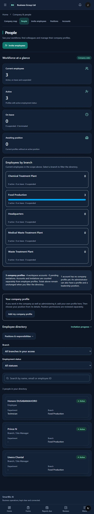

# Workforce, leadership setup and complete lists — 13 October 2026

This implementation follows the system readiness review. Public deployment remains on hold while the remaining form and infrastructure checks are completed.

## Workforce and access

- Employee directory rows now follow company-wide or branch-scoped directory permissions. Existing MANAGER accounts retain their permitted branch view; an account without a recorded branch does not gain access to all unassigned employees.
- `VIEW_ALL_EMPLOYEES` supports explicitly reviewed branch assignments. Branch directory access is read-only; employee-management authority remains company-scoped. Company-wide employee management no longer depends on the actor also having an ADMIN account role.
- Ordinary directory responses contain business directory information, not private profile fields. Personal contact data and confidential HR metadata require separate access; company management alone does not grant it. Private-field edits use the same checks.
- Employment actions are supplied to the frontend according to permission and current status. Active employees offer leave, employees on leave offer return, and suspended profiles offer reactivation. The last active company administrator cannot be suspended or terminated through these controls. Generic profile edits cannot bypass employment actions, rebind a profile to another account, or bootstrap position permissions.
- Status confirmations identify the employee and show failures. Browser checks opened and cancelled these dialogs; employment changes were tested only in the isolated database.

## People page and leadership setup

- Added totals for current employees, active profiles, leave, suspension, termination and missing positions, plus counts by branch. Counts use the same visibility boundary as directory rows and do not depend on the visible page or search filters.
- Company-wide viewers see employee profiles, workspace accounts and unexpired invitations counted separately. Branch viewers do not receive company-wide account/invitation counts.
- Added branch/status filters, clickable branch bars, a direct jump to the directory and compact chart presentation. All branches remain available through one expansion control and the branch filter.
- Administrators can add their own company profile with an employee ID, workplace, employment type and optional start date, then open its position assignment. Profile creation does not grant leadership or confidential permissions.
- Profile creation and workplace edits synchronize the account's recorded branch. Assigning a company-wide position without a fixed location preserves an existing workplace instead of clearing it. A first assignment to a position with a fixed location still sets the initial workplace. Self-position assignments refresh the actor's access and clear cached query data. Profile, position and employment actions also refresh the company-map people list.
- Added employee/leadership search terms and direct roles/permissions navigation. Reviewing a position carries its selection into the responsibility page. Standalone position choices and platform support replies now have unfinished-work protection.

## Support, records and organization choices

- Support responses include the company name. List responses omit conversation bodies and diagnostic context; detail responses retain authorized conversations, with internal notes excluded from customer views.
- Support status, priority and category filters now run on the server before pagination.
- Company support, platform support and official records pages preserve count/next/previous metadata and provide page controls. Official records also have loading, error and empty states.
- Branch, department, team, position and employee choice loaders read all authorized pages instead of stopping at the first 25 entries. They request fixed local endpoints rather than following response-provided URLs, deduplicate IDs and stop with an error if paging makes no progress.
- Document owners retain access to their document details after selecting a branch or management sharing audience. This does not grant access to other users' restricted documents; sensitive-file download checks remain separate.

## Verification

- Employee access, workflow scope, invitations, profile setup, workplace preservation and employment actions: **41 tests passed**.
- Support and official-record pagination/customer privacy: **6 tests passed**, including 26-record second-page cases and server-side queue filtering.
- Documents and report-notification privacy, including ownership across sharing audiences: **17 tests passed**.
- Frontend collection contracts passed for complete choices, fixed endpoints, paging-loop protection and preserved pagination.
- Full frontend lint and production build passed. The final build included TypeScript and all 92 generated pages; targeted checks covered subsequent workplace/setup refinements.
- Django system check and strict API schema validation passed. The migration check found no changes; no database migration is required for this batch.
- Signed-in checks verified company totals (3 profiles / 4 accounts), branch/status filtering, the profile form, named employee action dialogs, position deep links, location-specific directory wording, unfinished-work protection and platform company labels. Browser checks did not create a live profile, change employment status, save access grants or send support replies.
- Visual checks used the available in-app viewport. Physical-phone and controlled wide/narrow breakpoint verification remain separate staging checks.

## Remaining work

- Complete the combined/effective permission preview and remaining assignment simplification (R7).
- Clarify descriptive worksite answers versus the trusted branch of a form entry; add a permitted branch choice where appropriate (R8).
- Finish configured request-type fields, consistent form guidance and setup shortcuts (R9), and wider unfinished-work protection (R10).
- Review remaining older optional-module collection/state handling beyond the support, records and organization choices fixed here (remaining R12).
- Verify real scanner detection, email/reporting/storage evidence, backup restore, separate staging and devices before deployment (remaining R14).

