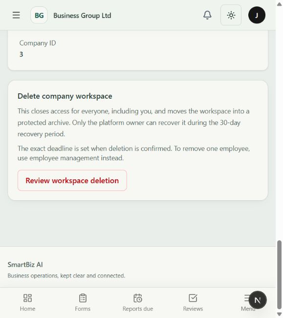

# Company workspace archive and recovery

15 October 2026. Added a separate archive lifecycle; existing company suspension and employee lifecycle actions retain their meanings.

## Implemented

- Company administrators can review workspace deletion from Company administration → Company profile. Company name, a reason and the actor's current password are required. The action moves the workspace into a protected archive for a 30-day recovery window, rather than deleting business records.
- Archive actions are rate limited. The transition locks the company, sets it inactive, records the actor/deadline/reason and terminates active company sessions. Pending/active support access grants end. Authentication and token refresh reject company access, and the deleting administrator clears local credentials and query data.
- Company APIs exclude archived workspaces. Platform Companies lists current workspaces by default and provides an Archived companies filter. Only platform owners have access to company lifecycle endpoints; support/security/auditor duties cannot recover archives.
- Recovery requires the platform owner's password, exact company name and reason. It restores the company's previous active/inactive state, preserves employee restrictions and does not revive ended sessions or support grants. Ordinary activate/reactivate routes cannot bypass archive recovery; a database constraint also prohibits active archived companies.
- Archive/recovery actions are audited. New migration `companies.0011_company_archive` was applied locally. The ordinary company profile serializer cannot change `is_active`; recovery administration cannot directly edit archive metadata or hard-delete companies.
- Company email delivery checks the current database archive state before sending. Reporting generation/reminders already select active companies; overdue processing now excludes archives.
- Employee deactivation/reactivation remains under company administration. Existing last-administrator guards and employment history are retained; this change does not erase user accounts or employee records.

## Evidence

- Four focused database/security tests passed in 293.68s: archive/recovery, role and company isolation, confirmation validation, database guard, old access-token rejection after archive and recovery, session/support-grant revocation, preservation of suspension and employee restrictions, deadline enforcement, and existing theme preference isolation.
- Strict API schema validation with fail-on-warning passed. Migration drift check passed. Frontend TypeScript and targeted ESLint checks passed, including the final redirect refinement.
- Signed-in browser: company admin confirmation fields and disabled submit verified, cancelled without submitting; platform owner detail entry and Archived companies filter verified. The archive list was empty, as expected. No real workspace was archived, recovered or erased during UI verification.

## Permanent deletion remains a separate release requirement

Automatic permanent cleanup is **not enabled**. After the 30-day deadline recovery closes and the archive awaits deletion review. It remains inaccessible; this is not a claim that data has been purged after 30 days.

Follow-up implementation now provides an explicit ownership inventory, retention holds, reviewed deletion previews, audited execution, resumable file cleanup and a separate backup-restore deletion ledger. See [permanent deletion behaviour and deployment prerequisites](workspace-permanent-deletion.md). It remains disabled by default; cloud/versioned storage, actual backup expiry and durable off-host ledger protection still require deployment validation. An unreviewed generic `company.delete()` remains unsuitable.

The latest whole-suite (403 tests) and production frontend build predate this feature. Repeat release checks before deployment. This evidence does not certify physical devices, production storage or external integrations.
