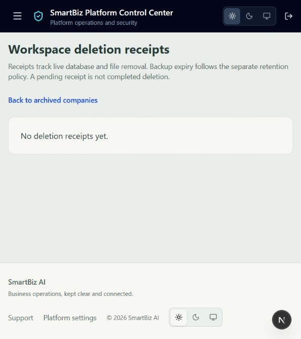

# Workspace permanent deletion

Implemented 15 October 2026. Workspace archiving remains the first step, with 30 days for platform-owner recovery. Expiry alone does not delete data: the platform owner reviews an explicit permanent-deletion preview.

## Behaviour and boundaries

- Only the platform owner can preview or confirm erasure, manage retention holds, view receipts or retry cleanup. Company users, support/security operators and auditors cannot use these endpoints.
- The preview checks expiry, hold, deployment readiness, the reviewed ownership inventory, incoming foreign keys and generic references, shared file references and supported storage. The owner confirms the exact name, current password, reason and backup policy. A fingerprint prevents an old preview from approving a different record/file set.
- The initial erasure uses a top-level PostgreSQL transaction. Runtime `PROTECT` and historical-record immutability are intentionally overridden **only** for the explicit reviewed company-owned row set. No cascades are followed. Unknown ownership or outside references block the operation; deferred database constraints are checked before commit and before any file deletion.
- The company and its business records, including employees' workspace history and company audit rows, are removed. Global user identities are retained, disabled and detached from the erased company; passwords/preferences/identity avatars are not erased by workspace deletion. Standalone personal-account erasure is a separate policy.
- Minimal platform audit evidence retains the owner, action, supplied reason, receipt and workspace ID. Do not put confidential company content in a deletion reason.
- A durable receipt retains the file manifest until file cleanup completes. A failed storage/ledger operation returns `FILES_PENDING`, not success. Retries recheck file references and are idempotent. Receipt responses never expose file paths or storage exceptions.
- Supported file removal currently covers unversioned local `FileSystemStorage` files tracked by the reviewed models: attachments, document versions, imports and company logos. Paths escaping the storage root or using symlinks are rejected. Versioned/cloud storage needs its own reviewed erasure adapter and remains blocked.
- Private exports are currently generated as streamed responses. Previously downloaded copies cannot be recalled. Application logs, shared backups, storage snapshots/object versions and external systems require their separately configured retention policy; `COMPLETE` means live reviewed database records and referenced supported files were removed, not that all historical copies have expired.

## Deployment defaults

Permanent deletion is disabled by default. Enable only after the isolated tests, storage inventory and backup restore drill pass:

```
WORKSPACE_PURGE_ENABLED=True
WORKSPACE_PURGE_BACKUP_RETENTION_DAYS=<verified positive policy duration>
WORKSPACE_PURGE_LEDGER_DIR=<existing protected durable absolute directory>
```

The ledger directory must be outside `MEDIA_ROOT` and `BACKUP_DIRECTORY`, separately protected and carried forward across database restores. A container filesystem alone is insufficient: mount protected durable storage into API and cleanup processes. The default examples intentionally leave it unconfigured; no hosting or storage was provisioned by this implementation.

No automatic initial deletion is scheduled. After expiry the owner can review an archive in Platform → Companies → Archived companies. Its permanent-deletion panel explains blockers, record/file totals and identity retention. Platform → Companies → Deletion receipts shows pending cleanup and supports password-confirmed retries.

An operator can also resume already approved cleanup using:

```
python manage.py resume_workspace_file_cleanup
```

This command cannot start a new workspace deletion. It processes only durable receipts for company database rows already removed.

## Restore without resurrecting erased companies

Keep the external deletion ledger current and protected. Each marker records a workspace ID, receipt and deletion timestamp; while cleanup is pending it also retains the private file manifest, including uploads newer than a restored backup. Completed markers clear that manifest.

Restore backups into an isolated environment with application traffic and workers stopped. Mount the **current** deletion ledger, not a copy from the historical backup, and run:

```
python manage.py apply_workspace_deletion_ledger --directory <current protected ledger directory>
```

This validates the directory before applying changes, blocks restored erased companies, terminates their sessions, prevents archive recovery, carries forward pending file cleanup and advances the company-ID sequence past erased IDs. It does not erase restored business rows automatically. The platform owner can review and erase those blocked rows again while preserving the older file manifest. Do not expose the restored service until that process and tenant-isolation checks finish.

A restoration performed without the current ledger is not a safe restore. Restrict database/file backup access and enforce expiry independently. Production backup expiry and off-host durability have not been verified locally.

## Local verification

- Final isolated PostgreSQL run: **14 passed in 179.23s**, covering archive and deletion boundaries, exact-name/password confirmation, recovery expiry, retention holds, disabled deployment, stale previews, shared files, outside-company FK/generic references, retained incident evidence, unsupported ownership/path rejection, failed cleanup and retry, ledger failure, backup-restore blocking, carry-forward of newer uploads and a late cross-company reference that forces database rollback before file deletion.
- Production frontend build passed for all **94 generated pages**, including TypeScript. Targeted lint, strict fail-on-warning API validation and migration drift checks passed.
- Migration `companies.0012_workspace_purge` was applied locally; it adds a hold field and receipt table without deleting business data.
- Signed-in platform browser verified the receipts page, explanatory copy and empty state. No real workspace was archived, purged or recovered as part of this verification. Archived detail controls were compiled; destructive transitions were exercised only with synthetic accounts and temporary files in the test database.
- The previous complete backend regression predates this change. Repeat the release regression and actual storage/backup restore drill before enabling the feature for customers.


