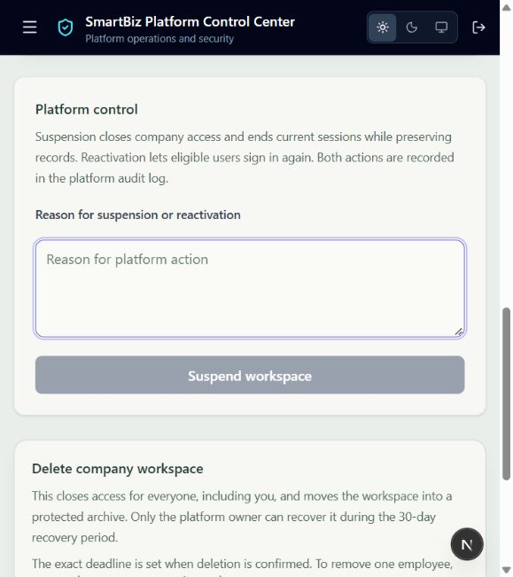

# Workspace suspension and reactivation

15 October 2026. Platform company controls now say **Suspend workspace** and **Reactivate workspace**. The company list and platform overview use **Suspended** for inactive, unarchived companies; subscription and individual-account status meanings are unchanged. Existing deactivate/activate/reactivate API URLs remain compatible.

Both transitions require a trimmed reason of at most 1,000 characters and platform-owner authority. A shared transaction locks the company, checks archive/deletion-ledger status, changes access and records the audit event. Duplicate/stale actions fail validation. Suspension ends sessions linked either directly to the company or through current user membership, including older sessions missing the company link. Pending/active support grants end too. Failure rolls back access, session changes and audit writes together.

Reactivation preserves records, existing employee restrictions and archive metadata. Ended sessions and support grants remain ended: eligible users must sign in again. Archived or erased workspaces cannot bypass their separate recovery/deletion lifecycle through ordinary reactivation.

## Verification

- Six focused suspension/archive tests passed in **59.59s**. Tests cover blocked existing access and new sign-in, old refresh/access-token rejection after reactivation, successful fresh sessions, preservation of form records and disabled employees, unaffected second-company access, legacy session termination, audit reasons, required/invalid reasons, authority boundaries, archive protection and rollback when audit persistence fails.
- Frontend TypeScript, targeted lint and strict fail-on-warning API validation passed. The final platform-overview text alignment received its own lint check.
- Signed-in browser confirmed the new label, labelled reason field, explanatory text and disabled submission without a reason. No live company was suspended or reactivated; business transitions used synthetic test data only.
- This is focused local evidence, not a guarantee for every production/device/concurrency scenario. Whole-suite release and staging infrastructure checks remain separate.

